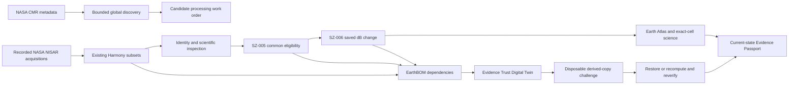

# Architecture

A Python 3.11 modular monolith. The new `public_app.py` configures an
operator-provisioned pinned archive, then opens the accepted Earth Atlas.
Existing `atlas_app.py` and `app.py` remain unchanged. Science and evidence
modules do not import Streamlit.

CMR results do not automatically become accepted pixel analysis. A new region
needs authorized known-size subsets and actual identity/channel/grid/support/QA
acceptance. The visitor workspace does not download full granules.

| Boundary | Package |
|---|---|
| Discovery / ingestion | `discovery/`, `ingestion/`, `application/global_explorer.py` |
| Protected data loading | `application/data.py`, `application/bundle.py` |
| Eligibility / saved change | `science/eligibility.py`, `preparation.py`, `change.py` |
| Environmental context | `corroboration/`; validated original-file import, no supplied rainfall |
| Evidence | `evidence/earthbom.py`, `lab.py`, `rebuild.py`, `impact.py` |
| UI | `presentation/earth_atlas.py`, local Canvas HTML/CSS/MJS and existing five-stage views |
| Reporting | `reporting/investigation.py`, independent of Streamlit |

No separate API, database, paid service, model API, CDN or map tiles are needed.
The prepared pilot is offline after installation/data provision. Explicit CMR
searches require public network access. See [deployment boundaries](deployment.md).
